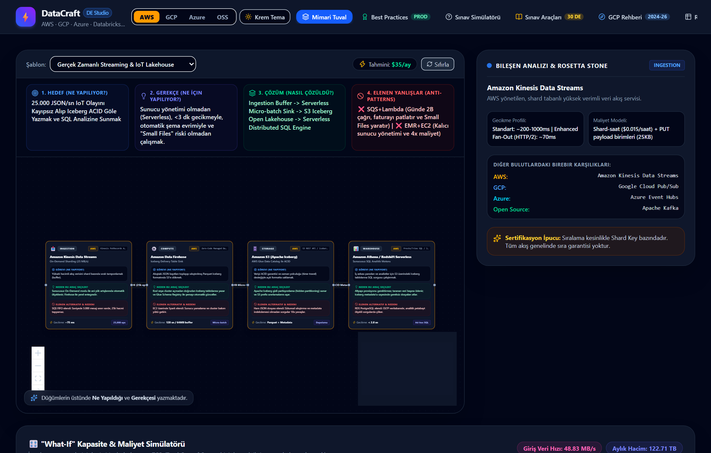
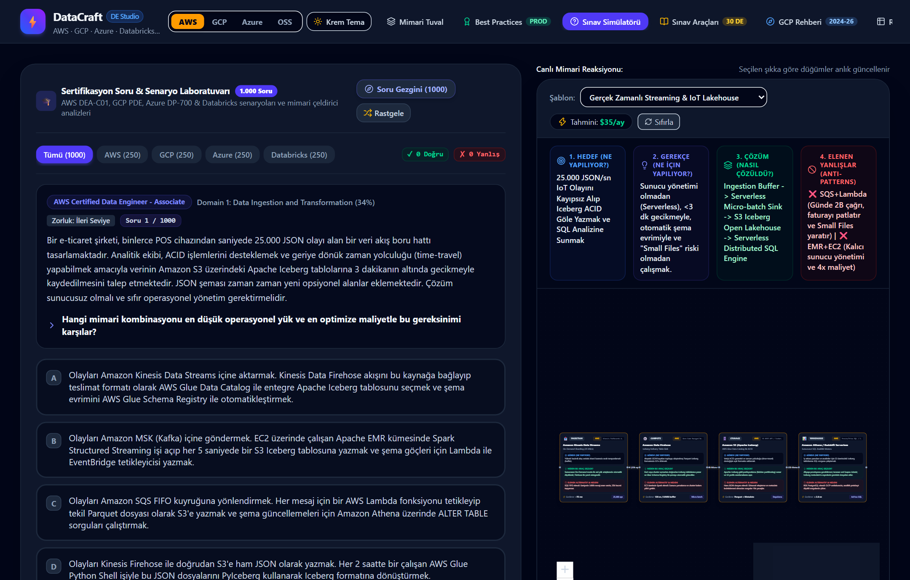
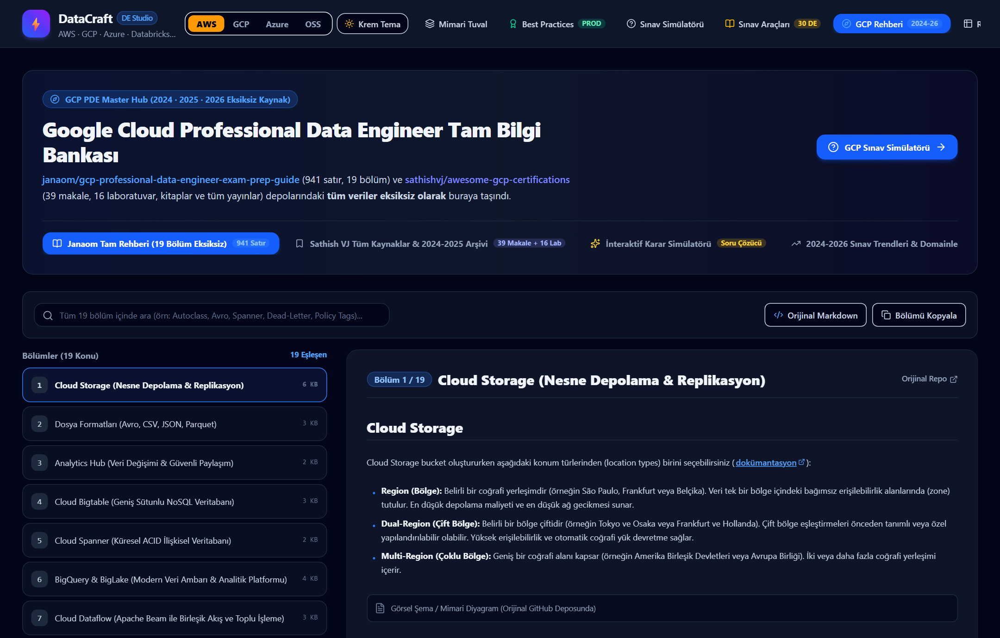
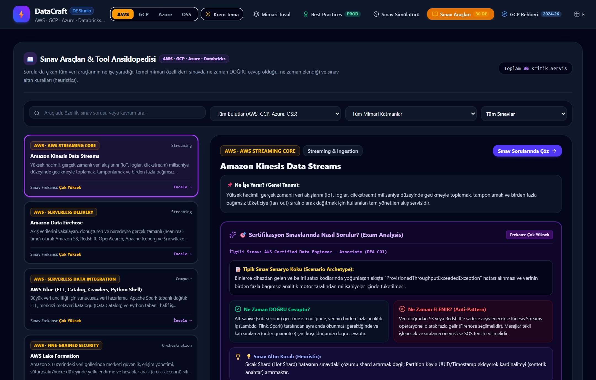
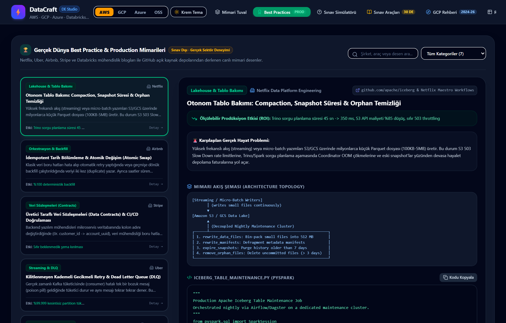
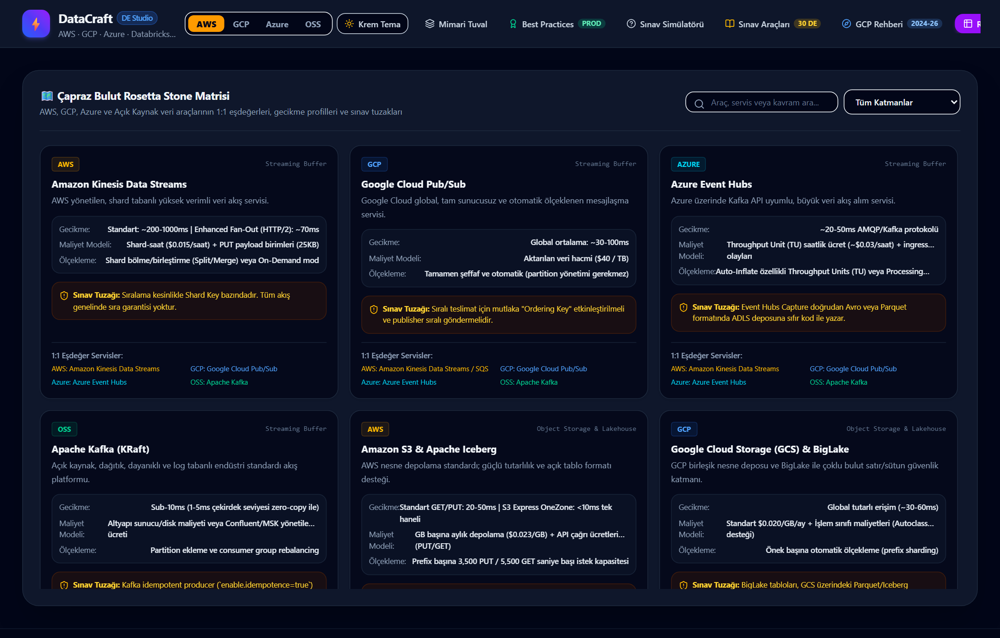
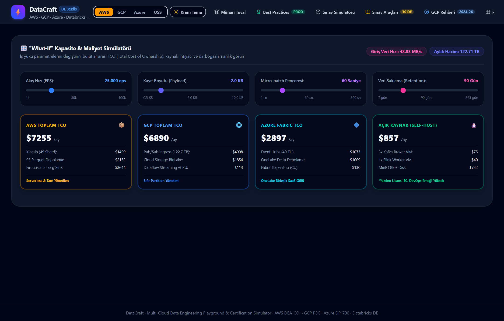
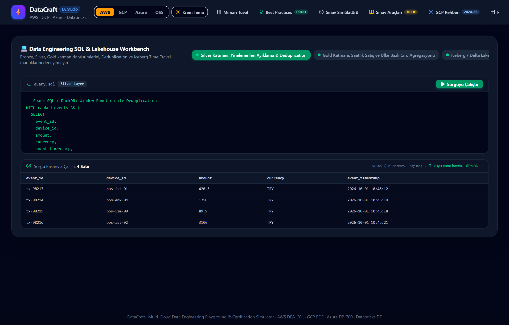
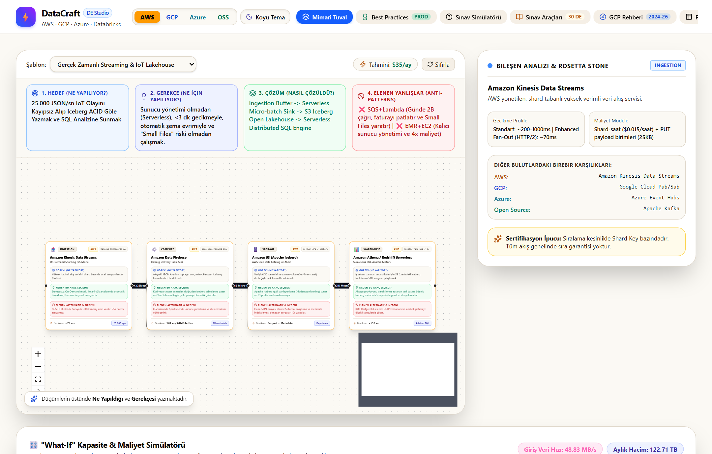
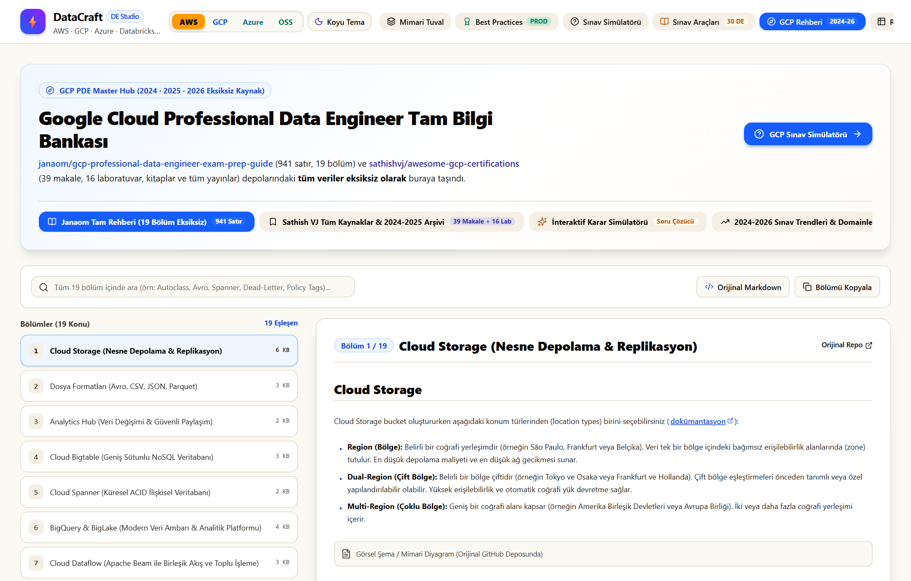

# ⚡ DataCraft · Multi-Cloud Data Engineering Playground & Certification Studio

**DataCraft**, veri mühendisliği adayları, kıdemli veri mimarları ve bulut sertifikasyonlarına hazırlananlar için geliştirilmiş açık kaynaklı, interaktif bir mimari simülasyon ve sınav laboratuvarıdır.

Uygulama; **AWS (DEA-C01)**, **Google Cloud (GCP PDE)**, **Azure (DP-700 / DP-203)** ve **Databricks (DE Associate)** ekosistemlerindeki tüm veri servislerini, mimari trade-off analizlerini, gerçek dünya üretim desenlerini (Best Practices) ve 1.000'den fazla senaryo tabanlı soruyu tek bir çatıda birleştirir.

---

## 📸 Ekran Görüntüleri (Platform Önizlemesi)

### 1. Çoklu Bulut Mimari Tuvali (Interactive Pipeline Canvas)
> AWS, GCP, Azure ve Açık Kaynak eşdeğerleri arasında anlık geçiş, interaktif veri akışı ve bileşen reaksiyonları.


---

### 2. Sertifikasyon Soru & Senaryo Laboratuvarı (1.000+ Soru Gezgini)
> AWS DEA-C01, GCP PDE, Azure DP-700 ve Databricks sınav senaryoları, her şık için gecikme, maliyet ve anti-pattern çeldirici analizleri.


---

### 3. Google Cloud Professional Data Engineer Tam Bilgi Bankası (Janaom & Sathish VJ)
> `janaom` (941 satır, 19 bölüm) ve `sathishvj` (39 makale, 16 Qwiklabs görevi, önerilen kitaplar) arşivinin eksiksiz Türkçe karar portalı.


---

### 4. Sınav Araçları & Tool Ansiklopedisi (30+ Data Engineering Servisi)
> Sorularda çıkan tüm veri araçlarının ne işe yaradığı, temel mimari özellikleri, doğru ve yanlış kullanım kriterleri ile sınav altın kuralları (heuristics).


---

### 5. Gerçek Dünya Üretim Desenleri (Production Best Practices)
> Netflix, Uber, Airbnb, Stripe ve Databricks kaynaklı üretim standartları (Idempotent Airflow DAG, Iceberg Compaction, Kafka Dead Letter Queue, Stripe Data Contracts, Debezium Outbox).


---

### 6. Çapraz Bulut Rosetta Stone Matrisi
> Ingestion, Streaming, Storage, Lakehouse, Compute, Warehouse ve Governance katmanlarında bulutlar arası 1:1 araç eşleştirme tablosu.


---

### 7. "What-If" Kapasite & TCO Maliyet Simülatörü
> Olay başına boyut (EPS), retention süresi ve mikro-batch pencerelerine göre canlı darboğaz ("Küçük Dosya Problemi") ve bulutlar arası TCO karşılaştırması.


---

### 8. SQL & Lakehouse Workbench
> Tarayıcı üzerinde çalışan yerel in-memory SQL motoru ile Bronze, Silver, Gold katman dönüşümleri, Deduplication ve Iceberg Snapshot Time-Travel denemeleri.


---

### 9. Sıcak Fildişi & Krem Tema Modu (Dual-Theme Engine)
> Göz yormayan lüks krem/fildişi tema desteği; zengin siyah mürekkep tipografi ve yüksek kontrastlı okuma deneyimi.




---

## 💻 Kendi Bilgisayarınızda Yerel Kurulum (Local Setup)

Bu uygulamayı kendi bilgisayarınızda (Windows, macOS veya Linux) tamamen yerel olarak çalıştırmak için aşağıdaki adımları izleyin:

### 1. Ön Gereksinimler
Bilgisayarınızda aşağıdaki yazılımların kurulu olduğundan emin olun:
- **Node.js**: Sürüm `18.0.0` veya üzeri (Önerilen: LTS sürümü) -> [Node.js İndir](https://nodejs.org/)
- **Git**: [Git İndir](https://git-scm.com/)

Kurulu sürümleri doğrulamak için terminal veya PowerShell üzerinden çalıştırın:
```bash
node -v
npm -v
git --version
```

---

### 2. Projeyi Klonlayın
Terminalinizi (Windows için PowerShell veya Git Bash, macOS/Linux için Terminal) açın ve projeyi bilgisayarınıza indirin:

```bash
git clone https://github.com/ysnblclr/datacraft-platform.git
cd datacraft-platform
```

---

### 3. Bağımlılıkları Yükleyin
Proje klasöründeyken gerekli Node paketlerini yükleyin:

```bash
npm install
```

---

### 4. Geliştirme Sunucusunu Başlatın (Live Dev Server)
Uygulamayı yerel geliştirme modunda çalıştırmak için:

```bash
npm run dev
```

> **İpucu (Aynı Ağdaki Mobil Cihazlardan Bağlanmak İçin):**
> Bilgisayarınızla aynı Wi-Fi ağına bağlı telefon veya tabletinizden test etmek isterseniz `--host` parametresini kullanabilirsiniz:
> ```bash
> npm run dev -- --host
> ```

Sunucu başlatıldığında konsolda aşağıdaki gibi bir çıktı göreceksiniz:
```text
  VITE v8.3.1  ready in 320 ms

  ➜  Local:   http://localhost:5173/
  ➜  Network: http://192.168.1.x:5173/
```

Tarayıcınızı açın ve [http://localhost:5173/](http://localhost:5173/) adresine gidin. Platform anında kullanıma hazırdır!

---

### 5. Üretim Derlemesi (Production Build)
Projeyi optimize edilmiş statik dosyalar halinde derlemek için:

```bash
npm run build
```
Bu komut TypeScript kontrollerini gerçekleştirir ve dağıtıma hazır minified dosyaları `dist/` klasörüne oluşturur.

Derlenen üretim sürümünü yerel olarak önizlemek için:
```bash
npm run preview
```

---

## 🛠️ Olası Sorunlar ve Çözümleri

| Sorun | Neden | Çözüm |
| :--- | :--- | :--- |
| **`Port 5173 is in use`** | Başka bir Vite veya React süreci 5173 portunu kullanıyor. | Vite otomatik olarak 5174 veya 5175 portuna geçer; terminaldeki yeni URL'i açın veya farklı bir port belirterek başlatın: `npx vite --port 3000` |
| **`Node sürüm uyumsuzluğu`** | Node.js sürümünüz 18'in altındadır. | `node -v` ile kontrol edin, [nodejs.org](https://nodejs.org/) üzerinden Node.js LTS sürümünü kurun. |
| **`EACCES / Permission denied`** | Paket yükleme izin hatası (macOS/Linux). | Klasör izinlerini kontrol edin veya `sudo` yerine `nvm` (Node Version Manager) kullanın. |

---

## 📦 Proje Yapısı

```text
datacraft-platform/
├── docs/
│   └── screenshots/          # Platform ekran görüntüleri (10 adet)
├── scripts/
│   └── capture_screenshots.js # Ekran görüntüsü otomasyonu
├── src/
│   ├── components/
│   │   ├── BestPractices/    # Production mimari desenler ve kod örnekleri
│   │   ├── Canvas/           # React Flow tabanlı pipeline tuvali ve DataNode'lar
│   │   ├── Exam/             # 1.000+ Soru sınav simülatörü ve gezgin
│   │   ├── GcpGuide/         # GCP PDE Master Hub (Janaom & Sathish VJ)
│   │   ├── RosettaStone/     # Çapraz bulut araç matrisi
│   │   ├── Simulator/        # What-If TCO & kapasite simülatörü
│   │   ├── ToolDirectory/    # Sınav araçları ansiklopedisi (30 DE servisi)
│   │   └── Workbench/        # In-memory Lakehouse SQL editörü
│   ├── data/                 # Soru bankası, şablonlar, makaleler ve rehberler
│   ├── types.ts              # TypeScript arayüz ve tip tanımları
│   ├── index.css             # Tailwind CSS & Yüksek Kontrastlı Çift Tema Motoru
│   └── App.tsx               # Ana uygulama çatı bileşeni
├── package.json              # Paket ve script tanımları
├── vite.config.ts            # Vite yapılandırması
└── README.md                 # Proje tanıtımı ve yerel kurulum kılavuzu
```

---

## 📄 Lisans
Bu proje [MIT Lisansı](LICENSE) altında geliştirilmiş açık kaynaklı bir eğitim ve simülasyon aracıdır.
